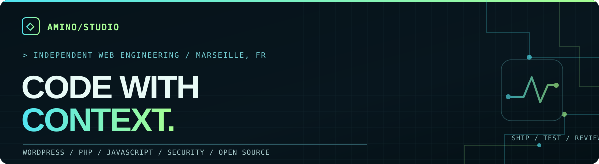

<!-- Amino/STUDIO · GitHub profile README · UTF-8 · no remote badges or trackers -->

  

  <strong>Independent web engineering · WordPress · Open source · Digital storytelling</strong>

  <a href="https://aminostudio.fr/">Website</a> ·
  <a href="https://github.com/aminostudio?tab=repositories">Repositories</a> ·
  <a href="https://www.linkedin.com/in/amine-mechai/">LinkedIn</a> ·
  <a href="mailto:hello@aminostudio.fr">Email</a>

---

### Hi, I'm Amine 👋

I run **Amino Studio**, an independent web development practice based in Marseille, France. For more than 15 years, I've connected **engineering, editorial thinking, design and infrastructure**, creating websites and digital experiences for organisations working across Europe, Africa and Latin America.

I build with **WordPress, PHP and JavaScript**; maintain **Linux-based hosting infrastructure**; and work on **performance, technical SEO, accessibility and security**. Documentary filmmaking, photography and motion design remain part of my toolkit, especially when technology needs to serve a story.

> **My approach:** understand the context, keep the architecture maintainable, test what matters, document decisions, then ship responsibly.

### Building in public

| Project | Focus | Status |
| :--- | :--- | :--- |
| [**ChronoArchive**](https://github.com/aminostudio/chronoarchive) | WordPress chronological archives, legacy compatibility and modern QA | **Development beta**, not released; security review ongoing |
| **Privacy-first WordPress tooling** | Consent management and responsible third-party integrations | In development, **not released** |

I believe open-source projects earn trust through readable code, transparent limitations, preserved upstream attribution and reproducible tests. A passing syntax check is a beginning, not a security certificate.

### What I work with

**Development:** PHP · JavaScript · HTML/CSS · WordPress · Elementor · REST APIs · custom plugins · ACF  
**Infrastructure:** Debian · Nginx · MariaDB · Git · GitHub Actions · Cloudflare · backups and monitoring  
**Quality:** Security reviews · PHPUnit and browser testing · technical SEO · accessibility · performance  
**Creative:** UX/UI · editorial design · documentary filmmaking · photography · 2D motion design

### Across languages and borders

I work in **French, English, Spanish and Arabic**, with clients and collaborators in different cultural and technical environments. Good communication is part of good architecture.

### Let's connect

Looking for a thoughtful collaborator on a WordPress build, a plugin, a migration or a technically demanding editorial site?

**[Explore Amino Studio →](https://aminostudio.fr/)** · **[Get in touch](mailto:hello@aminostudio.fr)**

Independent work. Built to be understandable, secure by design and maintainable over time. · Amino/STUDIO
